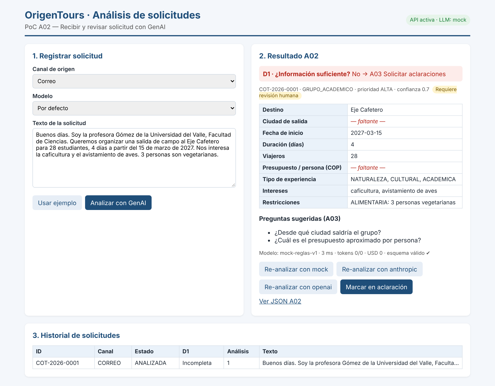

# OrigenTours · PoC A02

**Proyecto Hito 1 · Inteligencia Artificial para Negocios Digitales · MAIT · Universidad de los Andes · Grupo 9**

PoC de la actividad **A02 — Recibir y revisar solicitud** del proceso de cotización de experiencias de OrigenTours. La persona asesora registra el mensaje del cliente; el sistema estructura sus requerimientos, determina si la información es suficiente (**D1**) y genera una salida A02 en JSON validada con JSON Schema.

**Repositorio:** [github.com/NovaDevSas/origentours-a02-poc](https://github.com/NovaDevSas/origentours-a02-poc) · **Rama:** `main`

## Alcance funcional

- API REST en Node.js y Express para registrar, consultar y actualizar solicitudes.
- Orquestador A02 con proveedores intercambiables `mock`, `anthropic` y `openai`.
- Validación de respuesta con AJV y cálculo determinista de campos faltantes para D1.
- Consola de asesor en React para analizar, revisar, reanalizar y ver historial.
- Pruebas automatizadas con `node:test` y Supertest sobre casos sintéticos.
- Diagramas de proceso, entidades, casos de uso y arquitectura en `docs/diagramas/`.

La captura usa datos ficticios y el proveedor `mock`; no incluye información real de clientes ni requiere claves para la demostración inicial.



## Arquitectura de la PoC

```text
Asesor → Consola React → API Express → Orquestador A02 → Proveedor LLM
                                         ├→ AJV / JSON Schema
                                         ├→ Verificador D1
                                         └→ Repositorio en memoria
```

El repositorio en memoria mantiene el alcance de prototipo: al reiniciar el backend se pierde el historial. La PoC no se presenta como una solución de producción.

## Estructura

```text
backend/
├── src/routes/                 Endpoints de solicitudes
├── src/services/               Orquestación A02, completitud, validación y LLM
├── src/schemas/                 Contrato JSON Schema
├── src/repositories/            Persistencia temporal en memoria
├── data/solicitudes_sinteticas.json
└── test/                        Pruebas automatizadas
frontend/                        Consola del asesor en React + Vite
docs/diagramas/                  Diagramas fuente y sus imágenes
docs/09_app_poc.png              Evidencia visual de la consola
PROMPTS.md                       Prompts del codebase y del ticket OT-101
```

## Requisitos y configuración

- Node.js 18 o superior.
- Para ejecutar sin costos, usar `LLM_PROVIDER=mock` (valor predeterminado).
- Para probar proveedores externos, configurar una clave propia en `backend/.env`; nunca subir ese archivo al repositorio.

```bash
cd backend
npm ci
cp .env.example .env
npm test
npm start                 # http://localhost:4000
```

En otra terminal:

```bash
cd frontend
npm ci
npm run dev               # http://localhost:5173
```

En `.env.example` se puede seleccionar `mock`, `anthropic` u `openai`. El proveedor `mock` permite revisar el flujo sin exponer credenciales ni invocar servicios externos.

## API principal

| Método | Ruta | Función |
|---|---|---|
| `GET` | `/api/health` | Estado de la API y proveedores disponibles |
| `GET` | `/api/esquema/a02` | Contrato JSON Schema de A02 |
| `POST` | `/api/solicitudes` | Registra y analiza `{ texto, canal, proveedor? }` |
| `POST` | `/api/solicitudes/:id/analisis` | Reanaliza con otro proveedor para comparar resultados |
| `GET` | `/api/solicitudes` | Consulta el historial de la sesión del backend |
| `PATCH` | `/api/solicitudes/:id/estado` | Actualiza el estado de revisión |

Ejemplo:

```bash
curl -X POST http://localhost:4000/api/solicitudes \
  -H 'Content-Type: application/json' \
  -d '{"canal":"WHATSAPP","texto":"Somos 4 personas, queremos ir a Cartagena 5 días en junio de 2027 saliendo de Bogotá, presupuesto 2,5 millones por persona."}'
```

## Validación automatizada

```bash
cd backend && npm test
cd ../frontend && npm run build
```

GitHub Actions ejecuta ambas comprobaciones en cada `push` y `pull_request`. Los diagramas en `docs/diagramas/` conservan archivos fuente PlantUML, Mermaid y Python junto con sus exportaciones PNG.

## GenAI y trazabilidad

Consulta [PROMPTS.md](PROMPTS.md) para los prompts entregados con la base y el prompt del ticket **OT-101** (primera tarea de la HU-01). El código está separado por rutas, servicios, proveedores y contrato para que la implementación pueda revisarse contra el alcance funcional.
